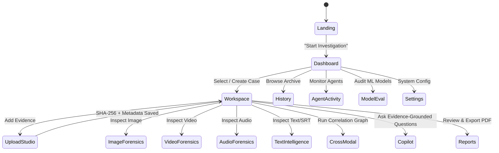

# TruthLens AI — Application Flow

## Primary End-to-End Investigation Flow
1. **Landing -> Dashboard**: Investigator reviews active cases, media breakdown, and recent agent runs.
2. **Create or Open Investigation**: Opens the Investigation Workspace (`INV-XXXX`) or uses the pre-seeded **Operation Pressline** multimodal demonstration case.
3. **Ingest (`Upload Studio`)**: Drops JPG/PNG/MP4/WAV/TXT/SRT files; server validates MIME/size, computes SHA-256, extracts container metadata, and stores immutable originals.
4. **Analyze (`Orchestrator`)**: Investigator triggers forensic analysis. Orchestrator inspects available evidence modalities and executes only relevant agents (Image, Video, Audio, Text) plus downstream Correlation, Risk Assessment, and Alternative Explanation agents.
5. **Inspect (`Modality Consoles`)**: Investigator zooms into ELA heatmaps, jumps to flagged video keyframes, plays back specific audio speech segments, and reviews text claim contradictions.
6. **Correlate & Interrogate (`Cross-Modal` + `Copilot`)**: Reviews evidence relationship graph and asks Copilot evidence-grounded questions with clickable source references.
7. **Review & Report (`Reports`)**: Records human investigator determination, generates executive synthesis, and downloads a structured forensic PDF.
