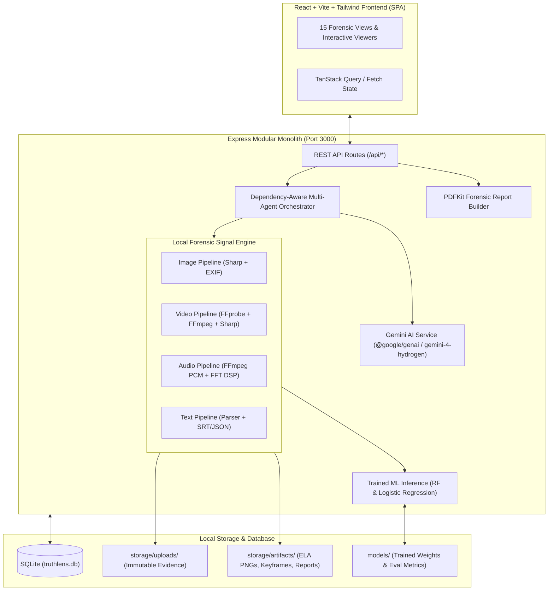

# TruthLens AI — Application Architecture

## Module Boundaries
- `server/db/`: Schema DDL, migrations, seed dataset generator, typed query helpers.
- `server/forensics/`: Image, Video, Audio, and Text pure signal extraction modules.
- `server/ml/`: Training pipeline, feature scaler, Random Forest & Logistic Regression inference, held-out evaluator.
- `server/agents/`: 9 specialized agents + dependency-aware DAG orchestrator.
- `server/ai/`: Server-only `@google/genai` client (`gemini-4-hydrogen`), structured JSON schemas, evidence retrieval for Copilot.
- `server/reports/`: PDFKit binary report builder.
- `server/routes/`: Modular Express routers for investigations, evidence, analysis, agents, copilot, models, reports, settings.
- `src/`: React Router SPA with custom design tokens, interactive forensic viewers, and Recharts visualizations.
