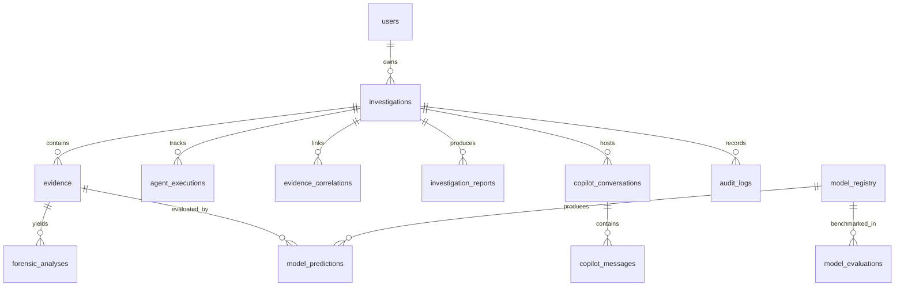

# TruthLens AI — Backend Database Schema

All relational state is persisted in SQLite (`storage/truthlens.db`) with `PRAGMA foreign_keys = ON` and `PRAGMA journal_mode = WAL`.

## Core Tables (13)
1. `users`: `id`, `name`, `email`, `role`, `avatar_url`, `created_at`
2. `investigations`: `id`, `case_code`, `title`, `description`, `status`, `assessment_summary`, `confidence_level`, `investigator_notes`, `owner_id`, `created_at`, `updated_at`
3. `evidence`: `id`, `investigation_id`, `original_filename`, `storage_path`, `mime_type`, `modality`, `file_size`, `sha256_hash`, `context_note`, `metadata_json`, `status`, `uploaded_at`
4. `forensic_analyses`: `id`, `evidence_id`, `investigation_id`, `modality`, `metrics_json`, `indicators_json`, `artifacts_json`, `limitations`, `analyzed_at`
5. `model_predictions`: `id`, `evidence_id`, `investigation_id`, `model_id`, `prediction_label`, `raw_score`, `uncertainty_note`, `feature_contributions_json`, `created_at`
6. `agent_executions`: `id`, `investigation_id`, `agent_name`, `responsibility`, `status`, `started_at`, `completed_at`, `input_summary_json`, `findings_json`, `error_message`, `related_evidence_ids_json`
7. `evidence_correlations`: `id`, `investigation_id`, `source_evidence_id`, `target_evidence_id`, `relationship_type`, `strength`, `summary`, `supporting_refs_json`, `alternative_explanations_json`, `created_at`
8. `investigation_reports`: `id`, `investigation_id`, `title`, `executive_summary`, `human_conclusion`, `report_json`, `pdf_path`, `generated_by`, `created_at`
9. `copilot_conversations`: `id`, `investigation_id`, `title`, `created_at`
10. `copilot_messages`: `id`, `conversation_id`, `role`, `content`, `cited_evidence_ids_json`, `created_at`
11. `audit_logs`: `id`, `investigation_id`, `actor`, `action`, `target_type`, `target_id`, `details_json`, `created_at`
12. `model_registry`: `id`, `name`, `version`, `modality`, `algorithm`, `source`, `checkpoint_path`, `license`, `input_spec`, `limitations`, `created_at`
13. `model_evaluations`: `id`, `model_id`, `dataset_name`, `dataset_license`, `sample_count`, `accuracy`, `precision_score`, `recall_score`, `f1_score`, `roc_auc`, `fpr`, `confusion_matrix_json`, `notes`, `evaluated_at`
